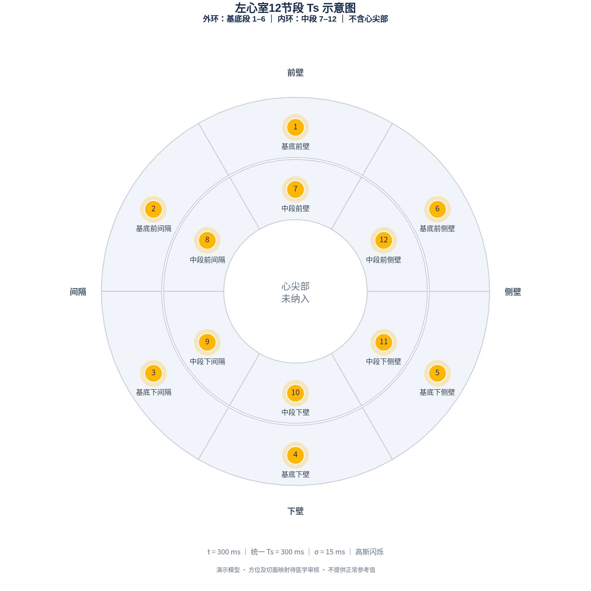

# -
左室12节段心肌同步可视化

## 可运行程序 V0.1

完整程序位于 **[lv_tdi_visualization](lv_tdi_visualization/)** 文件夹。

1. 在仓库页面点击绿色 **Code → Download ZIP**，下载并解压。
2. 安装 Python 3.11 或 3.12。
3. 进入解压后的 `lv_tdi_visualization` 文件夹，按 **[中文安装与操作说明](lv_tdi_visualization/README.md)** 安装依赖并启动。

程序启动后，把当前时间拖到 **300 ms**，12 个节段会同时达到最大显示亮度。牛眼图右上角相机按钮可导出高清 PNG，页面也支持 CSV 下载。

本版本为无患者数据的理想同步演示，亮度仅表示预设的组织多普勒峰值时间。默认 300 ms 是演示参数。后续研究的题目和范围不改变当前 V0.1 的具体实现范围。

## 模型图片

以下图片由 V0.1 程序实际运行生成。在 `t=Ts=300 ms` 时，12 个节段同时达到最大显示亮度；橙黄色仅表示到达预设 Ts。

[查看 t=0 ms 的灰色状态](docs/images/lv12_before_peak.png) · [查看中文交互界面截图](docs/images/app_at_peak.png)
